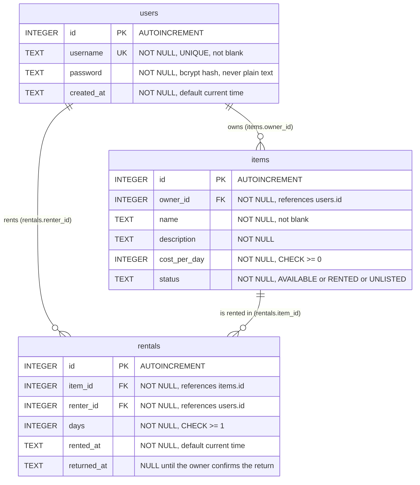

# Entity-Relationship Diagram

Three tables: `users`, `items`, `rentals`.

## Status

| Table | State |
|---|---|
| `users` | Implemented in `schema.sql` (merged to `main`). |
| `items` | **Proposal.** Columns to be agreed by the team. |
| `rentals` | **Proposal.** Columns to be agreed by the team. |

## Rules the schema enforces

- `users.username` is UNIQUE, so a taken name is rejected by the database.
- `items.owner_id` and `rentals.renter_id` point at `users.id`, and `rentals.item_id` points at `items.id`.
- A rental needs at least 1 day, and an item cannot have a negative cost.
- An item's `status` says whether it can be rented (AVAILABLE), is out (RENTED), or is hidden by its owner (UNLISTED).
- Ownership (only the owner can list, delist, relist and confirm a return) is checked in the service layer, not in the database.